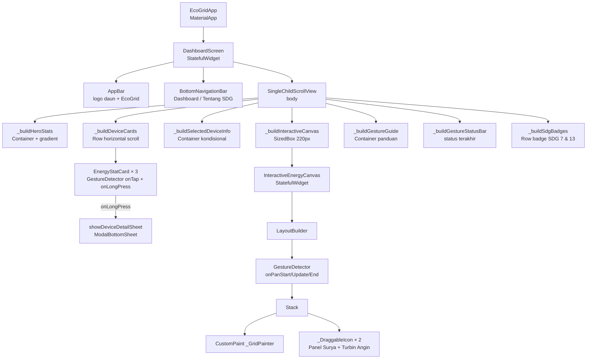

# EcoGrid — Renewable Energy Dashboard

> **Aplikasi mobile Flutter** untuk pemantauan dan visualisasi energi terbarukan secara interaktif.  
> Dibuat sebagai tugas kuliah **"Interactive Mobile UI dengan Flutter Gestures"**.

---

## 📌 Identitas

| Field | Nilai |
|---|---|
| Nama Aplikasi | EcoGrid — Renewable Energy Dashboard |
| NIM | 202431091 |
| Platform | Android (Flutter) |
| Bahasa UI | Indonesia |
| Deadline | 13 Oktober 2026, 15.00 WIB |
| GitHub | *(isi URL repository setelah di-push)* |
| Anggota Kelompok | *(isi nama anggota kelompok)* |

---

## 🎯 Tujuan Aplikasi

EcoGrid adalah dashboard mobile yang memungkinkan pengguna:

1. Memantau **produksi energi terbarukan** (simulasi) dari panel surya, turbin angin, dan baterai.
2. Berinteraksi dengan perangkat menggunakan **tiga jenis gesture Flutter** yang wajib: Tap, Long Press, dan Drag/Pan.
3. Mendukung tujuan **SDG 7** (Energi Bersih dan Terjangkau) dan **SDG 13** (Penanganan Perubahan Iklim).

---

## ✨ Fitur Utama

- **Hero Stats**: Total produksi energi, konsumsi, CO₂ hemat, dan uptime
- **Kartu Perangkat**: Panel Surya, Turbin Angin, dan Baterai dengan data simulasi
- **Detail Perangkat**: Modal bottom sheet berisi deskripsi dan statistik perangkat
- **Kanvas Interaktif**: Area untuk memindahkan ikon perangkat secara bebas
- **Panduan Gesture**: Petunjuk penggunaan gesture langsung di layar
- **Status Gesture**: Feedback real-time dari setiap interaksi pengguna
- **Bottom Navigation**: Beralih antara Dashboard dan halaman Tentang SDG
- **Tema Gelap**: Background hijau hutan dengan aksen hijau terang

---

## 👆 Penjelasan Gesture Wajib (NIM akhiran 1)

### 1. TAP Gesture
- **Implementasi**: `GestureDetector.onTap` pada `EnergyStatCard`
- **Cara kerja**: Ketuk salah satu kartu (Solar/Wind/Battery) untuk memilihnya. Kartu yang dipilih menampilkan border berwarna, latar belakang terang, dan badge "✓ Dipilih". Ketuk lagi untuk melepas pilihan.
- **Feedback visual**: Warna kartu berubah + badge dipilih + status bar diperbarui
- **State**: `_selectedCardIndex` di `_DashboardScreenState`

### 2. LONG PRESS Gesture
- **Implementasi**: `GestureDetector.onLongPress` pada `EnergyStatCard`
- **Cara kerja**: Tahan kartu selama ~500ms untuk membuka bottom sheet berisi nama perangkat, status, deskripsi, dan data energi simulasi.
- **Feedback visual**: Bottom sheet muncul dari bawah + status bar diperbarui
- **Tidak konflik**: Karena onTap dan onLongPress adalah callback terpisah di GestureDetector yang sama, keduanya tidak saling mengganggu

### 3. DRAG / PAN Gesture
- **Implementasi**: `GestureDetector.onPanStart`, `onPanUpdate`, `onPanEnd` di `InteractiveEnergyCanvas`
- **Cara kerja**: Sentuh dan seret ikon Panel Surya (kuning) atau Turbin Angin (biru) di kanvas interaktif. Posisi mengikuti jari secara real-time.
- **Batasan**: Elemen tidak bisa keluar area kanvas (diclamping dengan `Offset.clamp`)
- **Feedback visual**: Lingkaran menyala + koordinat x,y di status bar
- **Layout**: Menggunakan `LayoutBuilder` untuk mendapatkan batas area kanvas secara aman

---

## 🛠️ Teknologi yang Digunakan

| Teknologi | Versi | Keterangan |
|---|---|---|
| Flutter SDK | ≥3.13.5 | Framework utama |
| Dart | null safety | Bahasa pemrograman |
| Material Design 3 | bawaan | Komponen UI |
| GestureDetector | bawaan | Handler semua gesture |
| StatefulWidget | bawaan | Manajemen state |
| LayoutBuilder | bawaan | Batas ukuran kanvas |
| CustomPainter | bawaan | Grid latar kanvas |
| showModalBottomSheet | bawaan | Dialog Long Press |

*Tidak menggunakan dependency eksternal selain Flutter SDK standar.*

---

## 📁 Struktur Folder

```
ecosmart/
├── lib/
│   ├── main.dart                          # Entry point & konfigurasi tema
│   ├── models/
│   │   └── energy_device.dart             # Model & data simulasi perangkat
│   ├── screens/
│   │   └── dashboard_screen.dart          # Layar utama dashboard
│   └── widgets/
│       ├── energy_stat_card.dart          # Kartu statistik (Tap + Long Press)
│       ├── interactive_energy_canvas.dart # Kanvas interaktif (Drag/Pan)
│       └── device_detail_sheet.dart       # Bottom sheet detail perangkat
├── test/
│   └── widget_test.dart                   # Pengujian widget Tap & Long Press
├── android/                               # Konfigurasi Android
├── pubspec.yaml                           # Dependensi proyek
├── analysis_options.yaml                  # Aturan lint
└── README.md                              # Dokumentasi ini
```

---

## 🌳 Diagram Pohon Widget



---

## ⚙️ Prasyarat Instalasi

1. **Flutter SDK** ≥ 3.13.5 → [flutter.dev/docs/get-started/install](https://flutter.dev/docs/get-started/install)
2. **Android Studio** atau **VS Code** dengan ekstensi Flutter/Dart
3. **Android SDK** (API Level ≥ 21 — Android 5.0+)
4. **Perangkat Android** atau **Emulator** yang sudah dikonfigurasi

---

## 🚀 Cara Menjalankan Aplikasi

```bash
# 1. Masuk ke direktori proyek
cd ecosmart

# 2. Instal dependensi
flutter pub get

# 3. Periksa perangkat yang tersedia
flutter devices

# 4. Jalankan aplikasi (mode debug)
flutter run

# 5. Atau jalankan pada perangkat spesifik
flutter run -d <device-id>

# 6. Build APK (opsional, untuk produksi)
flutter build apk --release
```

---

## 🧪 Cara Menguji Masing-masing Gesture

### Tap Gesture
1. Buka tab **Dashboard**
2. Ketuk kartu **Panel Surya** → kartu berubah warna, badge "✓ Dipilih" muncul, status bar diperbarui
3. Ketuk kartu **Turbin Angin** → pilihan berpindah
4. Ketuk kartu yang sama lagi → pilihan dilepas
5. Verifikasi: status bar di bawah Panduan Gesture berubah setiap Tap

### Long Press Gesture
1. Tahan kartu **Panel Surya** selama ~500ms
2. Modal bottom sheet muncul dari bawah berisi: nama, status, deskripsi, statistik
3. Tekan tombol **Tutup** untuk menutup sheet
4. Coba Long Press pada kartu **Turbin Angin** dan **Baterai**
5. Verifikasi: status bar menampilkan "✋ Long Press: Detail [nama] dibuka"

### Drag / Pan Gesture
1. Scroll ke bagian **Area Interaktif** (kanvas bergrid gelap)
2. Tekan dan tahan ikon **Panel Surya** (kuning), lalu seret ke posisi baru
3. Tekan dan tahan ikon **Turbin Angin** (biru), lalu seret
4. Perhatikan: koordinat x,y diperbarui di status bar secara real-time
5. Coba seret ke tepi kanvas → elemen terhenti di batas, tidak overflow

---

## ⚠️ Catatan Data Simulasi

> Semua data yang ditampilkan di aplikasi ini — termasuk nilai produksi energi, efisiensi, kapasitas, CO₂, dan uptime — adalah **Data Simulasi** yang bersifat statis dan **tidak merepresentasikan kondisi nyata** dari perangkat energi manapun.
> 
> Data ini dibuat semata-mata untuk keperluan demonstrasi tugas kuliah.

---

## 📸 Cara Screenshot Gesture (untuk Laporan)

```bash
# Ambil screenshot dari perangkat/emulator yang terhubung
flutter screenshot --out=screenshots/before_tap.png
# [lakukan gestur]
flutter screenshot --out=screenshots/after_tap.png
```

Atau gunakan fitur screenshot bawaan perangkat (tombol Power + Volume Bawah).

---

## 📤 Cara Upload ke GitHub

```bash
# Inisialisasi repo (jika belum)
git init
git add .
git commit -m "feat: initial EcoGrid Dashboard implementation"

# Hubungkan ke remote
git remote add origin https://github.com/<username>/<repo-name>.git

# Push
git branch -M main
git push -u origin main
```

---

*Dibuat dengan Flutter 💚 | SDG 7 & SDG 13*
